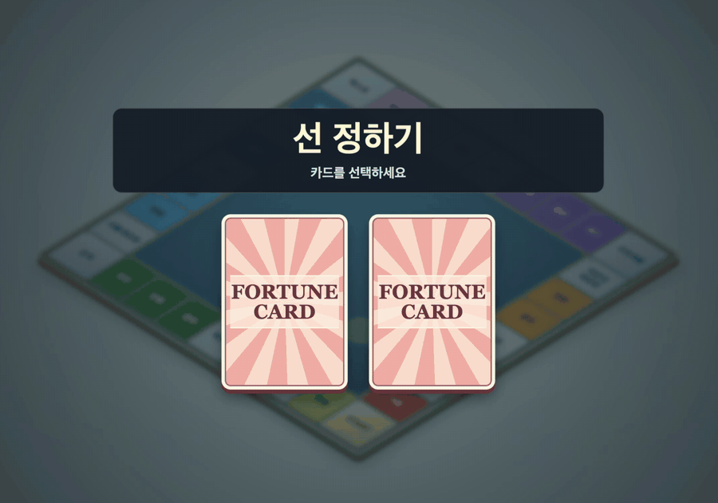
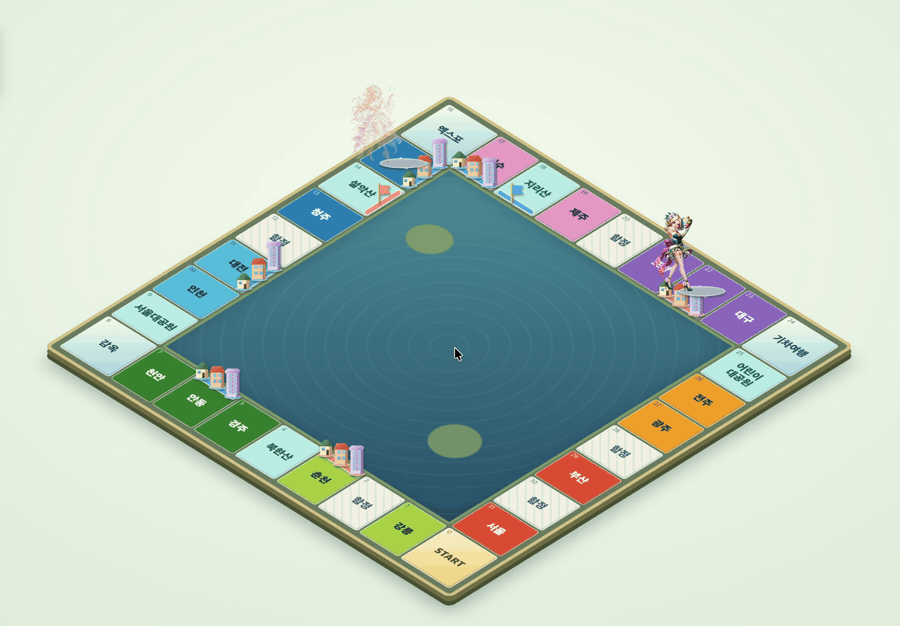
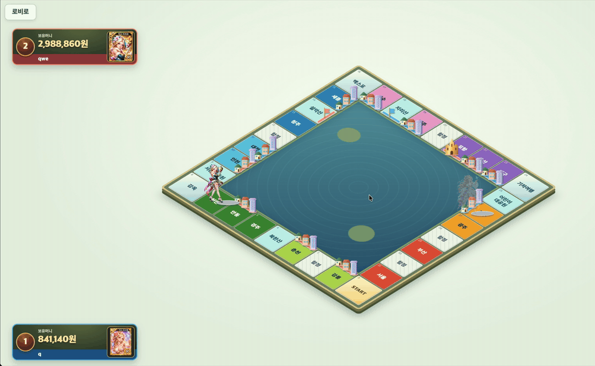

## 실시간 멀티 보드게임

 학창시절 모두의 마블을 잼있게 플레이한 기억이 있어 만들어본 프로젝트 입니다.       
 여러 플레이어가 같은 방에서 주사위를 굴리며, 땅을 구매하거나, 건물을 지으며 다른 플레이어의 땅에 도착하면 통행료를 내도록 만들었습니다.      
 
 이 프로젝트는 각 플레이어가 같은 게임 상태를 보도록 만들었습니다. 주사위 결과, 말 위치, 건물 소유권, 통행료, 다음 차례는 서버에서 결정 하며 브라우저는 웹소켓으로 받은 결과만 화면에 반영합나디.                     

 ## 기술 스택
백엔드:  java21, SpringBoot, SpringSecurity, Spring Data Jpa     
실시간통신:  Spring WebSocket, STOMP    
프론트엔드:  thymeleaf, HTML, CSS, JavaScript
데이터베이스:  MySQL

 ## 주요 기능

 로비, 대기방|  :방 생성과 입장, 실시간 채팅, 준비 상태확인, 발장의 게임시작      
    
 주사위, 이동  : 게임 시작 직후 턴을 정하는 카드 선택으로 차례 결정, 주사위 굴리기 말을 한 칸씩 이동 더블 시 추가 굴림, 세 번 연속 더블 시 감옥으로 이동       
   
 부동산       : 땅 구매, 건물 선택 건설, 랜드마크 업그레이드, 통행료 정산, 상대 땅 인수    
   
 특수 타일    : 특수 타일인 함정에 걸리면 랜덤한 위치로 이동, 기차여행에서는 원하는 목적지로 선택 이동    
   
 캐릭터, 아이템 : 캐릭터 카드 뽑기, 장착, 합성, 행운 아이템 뽑기, 장착, 삭제, 스킬 발동 시 아이템 이미지 표시
     
 게임 종료    :  통행료를 감동 못 한 플레이어는 파산 처리, 마기막 한 명이 남으면 게임 종료 및 결과 표시   
    

 ## 구현에서 신경 쓴 부분

 #### 착지 결과를 처리 한 다음 차례 진행
 말이 주사위 값 만큼 움직였다고 턴이 끝난게 아닙니다. 빈 땅이면 건물 건설, 내땅이고 건물 3개가 다 건설 됐다면 랜드마크 건설, 상대 땅이면 통행료 정산 후 인수 선택을 해야 했습니다.     
 GamePahse로 주사위 대기, 건설 대기, 통행료 대기, 인수 대기 등을 구분하고, 주사위와 통행료 같은 주요 요청에는 현재 플레이어 턴과 요청한 플레이어의 차례를 비교 하도록 했으며,
 플레이어 말이 타일에 도착후 행동을 다 하면 그때 주사위가 더블 여부에 따라서 같은 플레이어에게 추가로 주사위를 한 번 더 던지도록 했습니다.    

 #### 스킬마다 다른 발동 시점과 효과
 주사위 컨트롤:  발동하면 목표 합계를 만들어 실제 이동에 사용하도록 했습니다.    
     
 건설 장비:  건설 후 발동하면 출발지로 이동하고 내 소유의 건물 중 추가 건설하도록 했습니다.   

 힐링 여행권:  상대 땅에서 발동하면 통행료를 면제 받고 기차 여행 타일로 이동 후 원하는 목적지를 선택하도록 했습니다.

